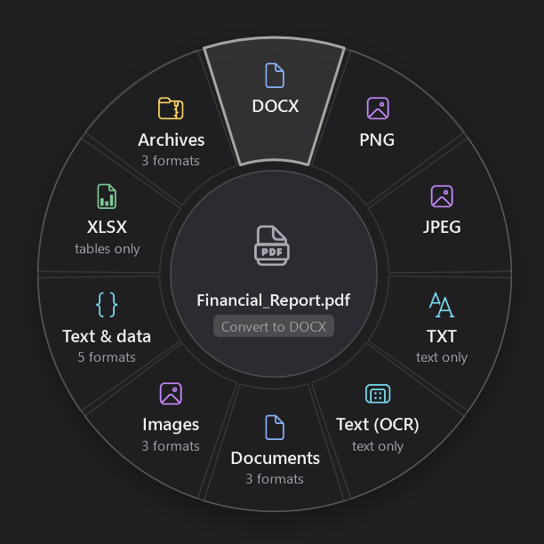
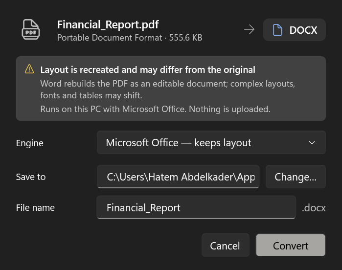

# FileOrbit

FileOrbit is a Windows desktop utility that converts files from a **radial menu** that opens around the
selected file. Right-click a file in Explorer (or press a shortcut), and a ring of the conversions
FileOrbit can *actually perform on this PC* appears around it. Pick one and the converted file is saved
next to the original. The original is never modified.

Everything runs locally. FileOrbit never uploads files and has no telemetry.



## Download

1. Go to [**Releases**](https://github.com/habdelkaderr/FileOrbit/releases) and download
   `FileOrbit-<version>-win-x64.zip`.
2. Unzip it anywhere (for example into `Documents\FileOrbit`) and double-click **FileOrbit.exe**.
   No installation and no .NET runtime are needed.
3. Select a file in File Explorer and press **Ctrl+Alt+Space**, or right-click it and choose
   **Show more options → Convert with FileOrbit**.

Requires Windows 10 (version 2004) or Windows 11, 64-bit. FileOrbit is not code-signed yet, so Windows
may show *"Windows protected your PC"*. Choose **More info → Run anyway**. On PCs with Smart App Control
turned on, unsigned apps can be blocked entirely until releases are signed.

## Contents

- [Using FileOrbit](#using-fileorbit)
- [What it can convert](#what-it-can-convert)
- [Limitations](#limitations)
- [Install, upgrade, uninstall](#install-upgrade-uninstall)
- [Development](#development)
- [Architecture](#architecture)
- [Security and privacy](#security-and-privacy)
- [Troubleshooting](#troubleshooting)

## Using FileOrbit

There are four ways to open the radial menu:

| How | Notes |
|---|---|
| **Right-click → Convert with FileOrbit** | On Windows 11 the entry is under **Show more options** (Shift+F10), the location available to unpackaged apps. Folders get **Compress with FileOrbit**. Multiple selected files open one menu for the whole batch. |
| **Global shortcut** (default **Ctrl+Alt+Space**) | Converts whatever is selected in the active File Explorer window, including Windows 11 tabs and the desktop. With nothing selected, it asks for a file. Change it in Settings. |
| **Drag and drop** | Drop files or folders anywhere on the FileOrbit window. |
| **Choose files…** | On the Home page or from the notification-area icon. |

### The radial menu

- The **centre** shows a preview of the file (the same thumbnail Explorer shows), its name, type and size.
  While you hover or focus a segment, it shows what that segment will do.
- The **first ring** holds the most relevant available actions. They are ranked by your pinned
  favourites, what you use most, and which targets are most commonly wanted for that file type.
- **Category segments** (Documents, Images, Audio, …) open a second ring. Crowded rings get a **More**
  segment. Click the centre, or press Backspace, to go back.
- **Dimmed segments** are conversions that need software you have not installed, such as
  "Needs FFmpeg". Choosing one explains what to install. It never pretends to work.
- Right-click a segment to **pin it to the first ring**.
- The number of segments adapts to the available screen space, and the menu never opens off-screen.

Keyboard: arrows or Tab move around the ring, Enter or Space selects, digits 1–9 select by position,
letters jump to a matching label, Backspace goes back, and Escape goes back or closes. The menu also
closes when you click outside it.

### The conversion card

After you pick an action, a compact card shows:

- the source, the target, and an honest **fidelity note** (for example "Layout is recreated and may
  differ from the original", or "Extracts content only"),
- the **engine** that will run it, with a choice when several are installed,
- only the **options** that matter (quality, resolution, pages, sheets…; rarely needed ones are under
  *More options*),
- the **destination folder** and **file name**. If the file already exists, you choose between
  *Keep both* (the default) and *Replace*. The source file can never be replaced.

The card then shows progress with **Cancel** and **Run in background**. When it finishes you get
**Open file**, **Show in folder** and **Convert again**, plus any warnings (for example "only the
first frame of an animated GIF was converted"). Failures show a clear message, with technical details
in an expander and a **Retry** button. Password-protected files prompt for a password, which is used
once and never stored.

Batches show a per-file list with status and progress. Mixed batches only offer actions every file
supports, and each file uses the best engine for its own format.



### The main window

**Home** (drop zone, recent conversions), **Queue** (background jobs: cancel, retry, show), **History**
(searchable, can be turned off and cleared), **Catalog** (every conversion with its engine, fidelity and
availability), **Engines** (dependency status, guided installation), and **Settings** (theme, Explorer
menu, shortcut, tray, start with Windows, notifications, output folder rules, collision default,
privacy, logs).

## What it can convert

FileOrbit decides what to offer from the file's **content** (magic bytes and container inspection),
not its extension, combined with which engines are **actually available**. A renamed file is treated as
what it really is. Every output is checked after conversion: its type is detected again from its bytes,
and a conversion that produced the wrong type or an empty file is reported as failed.

### Engines

| Engine | Ships with | Conversions |
|---|---|---|
| **Windows Imaging + Skia** | FileOrbit and Windows | PNG, JPEG, BMP, GIF, TIFF, ICO (multi-size), WebP, PDF from PNG/JPEG/BMP/GIF/TIFF/ICO/WebP*/HEIC*/AVIF*; SVG → PNG/JPEG/WebP/ICO and vector PDF; Resize; Compress. EXIF orientation is applied; metadata can be kept, kept without location, or removed. |
| **Windows PDF renderer** | Windows | PDF → PNG/JPEG (one per page; several pages go into a folder), multi-page TIFF, PPTX (one picture slide per page) |
| **PdfPig** | FileOrbit | PDF → TXT, Markdown, HTML, DOCX (text only), XLSX/CSV (heuristic table detection) |
| **Windows OCR** | Windows | Text (OCR) from scanned PDFs and images, in any OCR language installed in Windows |
| **Tabular (ClosedXML)** | FileOrbit | XLSX ↔ CSV/TSV/JSON/HTML, CSV ↔ TSV/XLSX/JSON, JSON → CSV/XLSX |
| **Open XML reader** | FileOrbit | DOCX → TXT, Markdown, HTML (headings, emphasis, lists, tables) |
| **Text (Markdig)** | FileOrbit | Markdown → HTML/TXT, HTML → TXT, TXT → HTML/Markdown |
| **Built-in archives** | FileOrbit | Extract ZIP/TAR/TAR.GZ/GZ; compress any file or folder to ZIP/TAR.GZ (folders also TAR); repackage between them |
| **Media Foundation** | Windows | MP3, M4A (AAC), WAV, WMA, FLAC from MP3/WAV/M4A/AAC/WMA/FLAC; audio extraction from MP4/MOV/WMV/AVI/MKV; video → MP4 (H.264/AAC) and WMV with resolution and quality presets |
| **Microsoft Office** | *Detected* | DOCX/DOC/RTF/ODT/TXT/HTML/Markdown → PDF (optionally PDF/A), DOCX, DOC, RTF, ODT, HTML, TXT and page images; **PDF → editable DOCX** (Word PDF Reflow); XLSX/XLS/ODS/CSV → PDF, XLSX, XLS, ODS, CSV; PPTX/PPT/ODP → PDF (optionally PDF/A), PPTX, PPT, ODP, slide images, **MP4 video** |
| **LibreOffice** | *Detected* | Writer/Calc/Impress conversions including OpenDocument formats |
| **FFmpeg** | *Detected* | MKV, WebM, MOV, AVI, OGG, Opus and more; animated GIF from video; stream copy (remux) |
| **7-Zip** | *Detected* | Extract 7Z, RAR and password-protected ZIP; create 7Z |
| **Ghostscript** (plugin) | *Detected* | PDF **Optimize** (smaller files) and **PDF/A-2b** |

\* needs the free *WebP*, *HEIF* (+ *HEVC*) or *AV1* image extensions from the Microsoft Store.

When several engines can do the same thing, the best **available** one is used (for example Word
before PdfPig for PDF → DOCX). The card lets you pick another, and your choice is remembered per action.
The **Catalog** page lists every conversion and why it is or isn't available on your PC.

## Limitations

FileOrbit does not claim universal or perfect conversion:

- **PDF → Word/Excel/PowerPoint is inherently lossy.** With Word installed, PDF Reflow produces an
  editable document but complex layouts, fonts and tables can shift. Without Word, PDF → DOCX extracts
  **text only**. PDF → XLSX detects tables from text positions and may need tidying. PDF → PPTX makes
  **picture slides** that are not editable.
- **Scanned PDFs** have no text layer. Use **Text (OCR)**. OCR quality depends on scan quality and the
  installed Windows OCR languages.
- **Only the first frame** of animated GIFs and multi-page TIFFs is converted by the image engine.
- **Office password-protected files** need Microsoft Office. Encrypted XLSX can't be read by the
  built-in spreadsheet engine.
- **Office automation can't be interrupted mid-call.** Cancel and the 10-minute watchdog end the Office
  process FileOrbit started, but never an Office window you had open. PowerPoint video export can take
  several minutes.
- **Windows 11's compact context menu** can't show unpackaged apps. The entry is under *Show more
  options*. A top-level entry would need a signed, packaged (MSIX/sparse package) shell extension.
- **Without optional engines** there is no MKV/WebM/OGG/Opus, no 7Z/RAR, no ODF fidelity without Office or
  LibreOffice, and no PDF optimisation or PDF/A from existing PDFs. These actions appear dimmed and
  say what is needed.
- **HEIC/AVIF output** is not offered (Windows encoders are not reliably present).
- **PDF/A** output is produced by Office or Ghostscript. FileOrbit does not certify conformance, so
  validate with a PDF/A checker if it is legally required.
- **The Ghostscript plugin** (PDF optimise and PDF/A from existing PDFs) has only been build-verified.
  Its integration tests need Ghostscript installed. On PCs with Smart App Control, the unsigned
  plugin may be blocked until release builds are code-signed. FileOrbit then lists it as blocked on
  the Engines page and keeps working.

## Install, upgrade, uninstall

**Installer:** `FileOrbit-<version>-x64.msi` (see [Building the installer](#building-the-installer)).

- Installs **per user** into `%LocalAppData%\Programs\FileOrbit`. No administrator rights.
- Adds a Start menu shortcut and the Explorer menu entries (HKCU only).
- Self-contained: no .NET runtime needs to be installed.
- **Upgrade:** run a newer MSI. A running FileOrbit is closed and files are replaced in place.
  Settings and history are kept.
- **Uninstall:** *Settings → Apps → Installed apps → FileOrbit → Uninstall* (or
  `msiexec /x FileOrbit-<version>-x64.msi`). This removes the program, the Explorer entries and the
  start-with-Windows entry. Your settings, history and logs in `%LocalAppData%\FileOrbit` are kept.
  Delete that folder to remove them too.

**Portable use:** `artifacts\publish\FileOrbit.exe` runs without installing. On first start it adds the
Explorer entry for your account (turn this off in Settings, or run `FileOrbit.exe --unregister-shell`).

Optional engines are installed separately. The **Engines** page links to each project and can open
a visible `winget install` command for you after you confirm. FileOrbit never downloads or installs
software silently.

## Development

### Requirements

- Windows 10 2004 (build 19041) or later, x64
- .NET 10 SDK (pinned in `global.json`)
- Optional, for the integration tests that use them: Microsoft Office, 7-Zip

### Build and run

```powershell
dotnet build
dotnet run --project src/FileOrbit.App              # main window
dotnet run --project src/FileOrbit.App -- "C:\path\file.pdf"   # radial menu for a file
```

### Tests

```powershell
dotnet test                                          # everything (Office tests take a few minutes)
dotnet test -- --filter-not-trait "Category=Office"  # skip Microsoft Office automation tests
```

The suite covers file-type detection, compatibility decisions, engine availability, path validation,
collision handling, cancellation and failure, radial menu generation, registry extensibility, batch
processing, shell argument handling and the single-instance channel. **Integration tests convert real
files.** Samples (PDF, PNG, JPEG, SVG, DOCX, XLSX, CSV, JSON, WAV, ZIP, TAR.GZ, GZ …) are generated on the
fly, so no third-party fixtures are redistributed. Each output is checked by its content signature
and, where useful, by reading it back with an independent library (PdfPig, ClosedXML, Open XML SDK)
or with real PowerPoint and Word. Tests for engines that are not installed are reported as
**skipped**, never as passed.

**UI snapshots:** `FILEORBIT_SNAPSHOT_DIR=<folder> dotnet test -- --filter-class "*UiSnapshotTests"`
renders the radial menu, conversion card and every main-window page in dark and light themes to PNG,
off-screen (nothing is shown or focused).

### Building the installer

```powershell
./build/Build-Installer.ps1        # publish + MSI → artifacts\FileOrbit-<version>-x64.msi
./build/Publish.ps1                # self-contained publish only → artifacts\publish
```

The MSI is built with the [WiX Toolset](https://wixtoolset.org/) MSBuild SDK, restored from NuGet. ICE validation needs an elevated build; in a normal shell WiX skips it with warning WIX1105.
Set the version in `Directory.Build.props`.

> **Code-sign every release.** Windows **Smart App Control** (on by default on new Windows 11 installs)
> and other App Control policies decide on *unsigned* files by cloud reputation, and verdicts vary per
> build. During development on a PC with Smart App Control enforced, some unsigned builds of
> `FileOrbit.dll`, `FileOrbit.Engines.dll` and the Ghostscript plugin were blocked while others of
> the same code were allowed. Sign `FileOrbit.exe`, all `FileOrbit.*.dll` files and the MSI with a
> trusted certificate (for example Azure Trusted Signing, or an OV/EV code-signing certificate)
> before distributing. Self-signed certificates are not trusted by Smart App Control.

**Self-contained vs framework-dependent:** releases are self-contained. FileOrbit targets .NET 10 LTS,
which most PCs don't have yet, and a context-menu tool must start instantly without a runtime prompt.
The cost is size: about 225 MB installed, from a 72 MB MSI. A framework-dependent build (`--self-contained false`) is much smaller
but requires the .NET 10 Desktop Runtime.

### Adding a format or engine

1. If the format is new, register a `FileFormat` (id, name, extensions, category) in `KnownFormats`,
   or at runtime with `FormatCatalog.Register`, and add its signature to `FileTypeDetector` if it has one.
2. Implement `IConversionEngine` (usually by deriving from `ConversionEngineBase`). Declare
   `ConversionCapability` records (source, target, fidelity, quality, options) and report availability.
   Write outputs only into `context.StagingDirectory`.
3. Add it to `EngineCatalog`, or ship it as a separate `FileOrbit.Engines.*.dll` plugin next to
   `FileOrbit.exe`. Plugins are discovered at start-up. If a plugin is missing or blocked, it is
   reported on the Engines page and doesn't stop the app.

The radial menu, catalog, card and queue pick it up automatically. No UI code changes are needed.

## Architecture

```
src/
  FileOrbit.Core       Pure .NET (no UI, no Windows APIs), fully unit-tested
    Formats/           FileFormat, KnownFormats, FormatCatalog (popularity hints)
    Detection/         FileTypeDetector: magic bytes, ZIP/OOXML/ODF inspection, text sniffing
    Capabilities/      IConversionEngine, ConversionCapability, options, CapabilityRegistry, ConversionAction
    Planning/          PathSafety (input/output validation, zip-slip), OutputPlanner (names, collisions)
    Jobs/              ConversionRunner (staging → validate → finalise), ConversionQueue, OutputValidator
    Radial/            RadialMenuBuilder: rings, categories, paging, ranking
    Settings/          AppSettings, SettingsStore, HistoryStore (JSON under %LocalAppData%\FileOrbit)
    Logging/           Structured JSON-lines file log (7-day retention)
    Shell/             Command-line parsing
  FileOrbit.Engines    Conversion engines (one class each) + ProcessRunner/ExecutableLocator + plugin loader
  FileOrbit.Engines.Ghostscript   Optional engine plugin
  FileOrbit.App        WPF UI and Windows integration
    Radial/            RadialMenuWindow + RadialSegment (annular-sector buttons with UI Automation)
    Conversion/        ConversionWindow (the card)
    Main/              Main window pages
    Shell/             Explorer verbs, single-instance pipe, hotkey, Explorer selection, tray, thumbnails
    Theming/           Fluent theme + FileOrbit palette, Segoe Fluent Icons glyphs
tests/FileOrbit.Tests  Unit, integration and off-screen UI snapshot tests (xUnit v3)
installer/             WiX per-user MSI
build/                 Publish and installer scripts
```

**How a conversion runs:**

1. `FileTypeDetector` identifies the input by content.
2. `CapabilityRegistry` lists actions, each backed by the best available engine.
3. The user picks one.
4. `ConversionRunner` validates the paths and creates a hidden **staging folder on the destination
   volume**, and the engine writes only there.
5. `OutputValidator` re-detects every produced file.
6. Outputs are moved into place with collision handling: never the source, never a silent overwrite.
7. The staging folder is always deleted, including after failure and cancellation.

**Technology choices:**

- **WPF** rather than WinUI 3: the radial menu needs a borderless, per-pixel-transparent, topmost
  window, which is first-class in WPF. The Fluent theme gives standard controls a modern Windows 11
  look.
- **Windows Runtime APIs** (Windows.Data.Pdf, Windows.Graphics.Imaging, Windows.Media.Transcoding,
  Windows.Media.Ocr) provide many conversions with no extra download.
- **Heavy, licence-sensitive tools** (FFmpeg, LibreOffice, Ghostscript, 7-Zip) are detected, never
  bundled.

## Security and privacy

- **Local processing only.** No network calls, uploads, telemetry or analytics. SVG and HTML inputs have
  remote references stripped before rendering, so even Word or Skia can't fetch them.
- **Untrusted input.** Detection is by content. Paths are normalised and validated (no device paths,
  alternate data streams, reserved names or relative paths). Archive extraction rejects absolute and
  `..` paths (zip slip), skips links, and enforces size, entry-count and compression-ratio limits.
  SVGs with DTD/entity declarations are refused. Image size is bounded.
- **External tools** run without a shell. Arguments are passed as a list (no command injection),
  executables are absolute paths found in known locations or PATH (never the current directory), and
  children are bound to a kill-on-close Job Object with timeouts.
- **Office automation** runs with macros force-disabled, read-only, alerts suppressed, and with a dummy
  password, so protected files fail fast instead of showing a dialog. For PDF → Word, the "Word will
  now convert your PDF" notice is switched off (`DisableConvertPdfWarning` under
  `HKCU\Software\Microsoft\Office\<version>\Word\Options`) only for the duration of that conversion,
  because an invisible Word cannot be dismissed. Your previous value is restored afterwards.
- **Outputs** are written to a private staging folder and moved into place. The source is never
  modified or replaced. Converted files are never opened automatically, and executables are never
  launched even on request.
- **Passwords** are prompted for deliberately, used once, and cleared from memory references
  afterwards. They are never stored or logged. They are passed to 7-Zip and Ghostscript as process
  arguments, which other processes of the same user could read while the conversion runs.
- **CSV exports** neutralise spreadsheet formula injection (`=`, `@`, and `+`/`-` followed by a
  non-number).
- **History and logs** stay on the PC (`%LocalAppData%\FileOrbit`). Both can be cleared in Settings,
  and history can be turned off. Logs contain file paths but never file contents.

## Troubleshooting

| Problem | Fix |
|---|---|
| No "Convert with FileOrbit" in the Windows 11 menu | Use **Show more options** (Shift+F10). Check *Settings → Windows integration*. |
| The shortcut does nothing | Another app may own it. Settings shows a message if registration failed; pick another combination. The shortcut needs FileOrbit running (keep *Run in the notification area* on). |
| "Needs FFmpeg / 7-Zip / LibreOffice / Ghostscript" | Install it (the Engines page shows how), then press **Check again**. For non-standard locations use **Locate…**. |
| HEIC, WebP or AVIF photos can't be opened | Install the free *HEIF Image Extensions* + *HEVC Video Extensions*, *WebP Image Extensions* or *AV1 Video Extension* from the Microsoft Store. |
| "An Application Control policy has blocked this file", FileOrbit doesn't start, or an engine plugin is listed as blocked | Smart App Control or WDAC blocked an unsigned FileOrbit file (see *Code-sign every release*). Use a signed build. A blocked *plugin* only disables that engine; a blocked `FileOrbit.dll` stops the app from starting. Details are in Event Viewer under *Applications and Services Logs → Microsoft → Windows → CodeIntegrity → Operational*. |
| An Office conversion takes very long | FileOrbit stops Office after 10 minutes (1 hour for video) and reports it. Large PDFs in Word PDF Reflow can be slow. |
| A conversion failed | Open *Technical details* on the card or the Queue page. Logs are in `%LocalAppData%\FileOrbit\logs` (*Settings → Open log folder*). |
